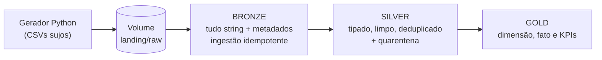
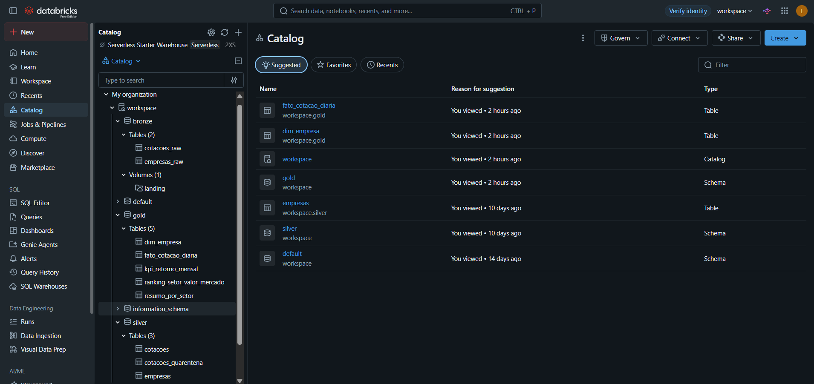
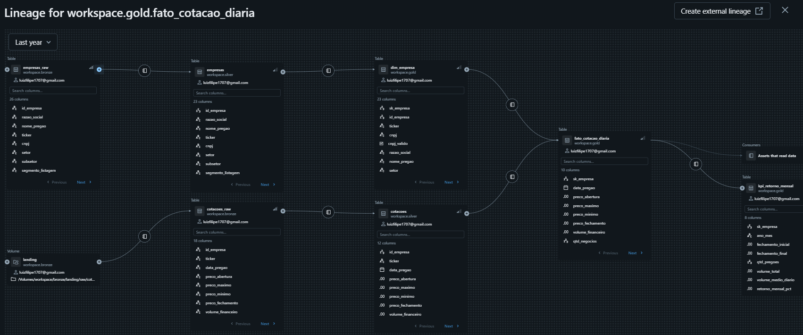
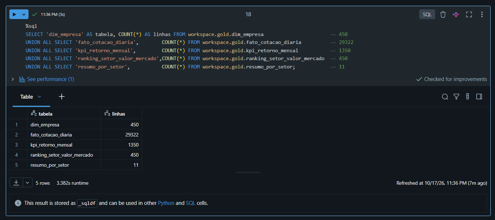

# B3 Lakehouse: pipeline de dados em arquitetura medalhão no Databricks

Projeto de engenharia de dados que transforma dados brutos e "sujos" de empresas listadas na bolsa em tabelas confiáveis e prontas para análise, usando **arquitetura medalhão (Bronze → Silver → Gold)** no **Databricks** com **Unity Catalog**.

> **Os dados são fictícios.** Tickers, nomes, CNPJs e cotações foram gerados por um script em Python (com apoio de IA), e não representam empresas reais. Os problemas de qualidade foram plantados de propósito e catalogados, o que permitiu validar cada tratamento contra um número esperado.

**Stack:** Python · PySpark · Spark SQL · Delta Lake · Unity Catalog (catálogos, schemas, volumes, linhagem) · Git/GitHub (branches e pull requests)

---

## Arquitetura



| Camada | Schema | Papel | Tabelas |
|---|---|---|---|
| Landing | `bronze.landing` (volume) | Recebe os arquivos exatamente como chegam | CSVs de cadastro e de cotações |
| **Bronze** | `workspace.bronze` | Guarda o dado bruto, com rastreabilidade | `empresas_raw`, `cotacoes_raw` |
| **Silver** | `workspace.silver` | Limpa, tipa, valida e deduplica | `empresas`, `cotacoes`, `cotacoes_quarentena` |
| **Gold** | `workspace.gold` | Modela para responder perguntas de negócio | `dim_empresa`, `fato_cotacao_diaria`, `kpi_retorno_mensal`, `ranking_setor_valor_mercado`, `resumo_por_setor` |

---

## Estrutura do repositório

```
notebooks/
├── 00_setup_unity_catalog     # schemas bronze/silver/gold e volume landing
├── 01_gerar_dados_brutos      # gerador de dados fictícios e sujos
├── 02_bronze_ingestao         # CSV → tabelas Delta (bronze)
├── 03_perfilamento_bronze     # diagnóstico da qualidade antes de tratar
├── 04_silver_empresas         # limpeza e tipagem do cadastro
├── 04_silver_cotacoes         # limpeza, quarentena e integridade com empresas
└── 05_gold                    # dimensão, fato, KPIs e ranking
```

---

## Os dados e os problemas planejados

| Problema plantado | Onde | Como foi tratado |
|---|---|---|
| Duplicatas exatas e "quase" duplicatas (caixa e espaços diferentes) | empresas e cotações | Deduplicação por chave natural, **depois** da limpeza |
| Nulos disfarçados (`N/A`, `N/D`, `n/d`, vazio) | empresas | Convertidos em `NULL` |
| Datas em 5 formatos (e só o ano) | empresas | Função que tenta cada formato; "só ano" vira `NULL` |
| Datas em 3 formatos | cotações | Mesma abordagem |
| Valores em formato brasileiro (`R$ 1.234,56`) misturados com `1234.56` | `valor_mercado` | Regra separada por formato, para não perder o decimal |
| Vírgula decimal em preços | cotações | Troca por ponto e conversão segura |
| Preços nulos, zero ou negativos | cotações | Tabela de **quarentena** com o motivo |
| CNPJ com e sem pontuação, e com 13 dígitos | empresas | Só dígitos + coluna `cnpj_valido` |
| Caixa e espaços inconsistentes (`ATIVA`, `ativa`, ` Ativa`) | empresas e cotações | `trim`, `upper` e `initcap` |
| Colunas irrelevantes | ambas | Descartadas na silver |
| **Chave com tipos diferentes** (`'000123'` nas cotações, `123` no cadastro) | `id_empresa` | Conversão para `INT` nos dois lados |

---

## O que cada camada faz

### Bronze: guardar sem interpretar
- Tudo entra como **string**, e uma leitura nunca falha por causa de dado sujo.
- Metadados de rastreio: `_source_file` e `_ingestion_ts`.
- Ingestão **idempotente por arquivo**: rodar duas vezes não duplica (476 e 30.294 linhas nas duas execuções).
- Nenhuma correção: se a regra de negócio mudar, reprocessa-se silver e gold sem depender da fonte.

### Silver: limpar e confiar
- **Perfilamento antes de tratar:** as queries do notebook 03 mostraram o que estava errado, e cada tratamento foi conferido contra esses números.
- **Tipagem segura:** `try_cast` em vez de `cast`, que devolve `NULL` em vez de derrubar a execução.
- **Reconciliação:** a contagem de nulos antes e depois da conversão precisa fechar (por exemplo, datas: 33 nulos + 13 "só ano" = 46 nulos depois).
- **Quarentena:** cotações com preço inválido vão para `silver.cotacoes_quarentena` com o motivo, em vez de serem apagadas.
- **Integridade entre tabelas:** cada cotação precisa ter uma empresa e o mesmo ticker do cadastro.

### Gold: modelar para o negócio
- `dim_empresa`: uma linha por empresa, com chave substituta (`sk_empresa`) e colunas de histórico (`data_inicio`, `data_fim`, `flag_atual`).
- `fato_cotacao_diaria`: uma linha por empresa e dia, com retorno diário (`LAG`).
- `kpi_retorno_mensal`: retorno e volume por empresa e mês.
- `ranking_setor_valor_mercado`: `RANK()` por setor.
- `resumo_por_setor`: agregações por setor.

---

## Validações de qualidade (resultados)

| Verificação | Resultado |
|---|---|
| Empresas: bronze → silver | 476 → **450** (26 duplicatas removidas) |
| Cotações: bronze → silver | 30.294 → **29.700** (594 duplicatas removidas) |
| Cotações válidas + quarentena | 29.322 + 378 = **29.700** |
| Empresas × dias de pregão | 450 × 66 = 29.700 |
| JOIN cotações × empresas **na bronze** (texto) | **0 linhas** |
| JOIN cotações × empresas **na silver** (INT) | **todas as linhas** (29.322) |
| Cotações sem empresa correspondente | **0** |
| Tickers divergentes entre cotação e cadastro | **0** |
| Linhas na gold | `dim_empresa` 450 · `fato_cotacao_diaria` 29.322 · `kpi_retorno_mensal` 1.350 · `ranking` 450 · `resumo_por_setor` 11 |

**Um caso real de validação:** os tipos e contagens da silver de cotações passavam, mas a checagem de integridade **entre tabelas** revelou 662 tickers divergentes (cotações em minúsculas, cadastro em maiúsculas). Só olhar cada tabela isoladamente não teria pegado o erro.

---

## Decisões técnicas

| Decisão | Motivo |
|---|---|
| Bronze toda em string | Não perder nem quebrar a leitura com dado sujo; a interpretação é da silver |
| `try_cast` no lugar de `cast` | O modo ANSI do serverless derruba a execução no primeiro valor inválido |
| Regra separada para `valor_mercado` BR e simples | No formato BR o ponto é milhar; no simples é decimal. Limpar igual multiplicaria valores por 100 sem erro visível |
| `valor_mercado` mantido em reais na silver | A silver preserva o dado; a escala de apresentação fica para a gold |
| Quarentena em vez de descarte | Preço inválido não serve para o retorno, mas o motivo do erro fica auditável |
| 4 valores negativos de `num_funcionarios` viraram `NULL` | Corrigir o sinal seria adivinhar; `NULL` não inventa informação |
| "Só ano" nas datas vira `NULL` | Inventar dia e mês criaria uma data que não existe |
| CNPJ inválido marcado, não apagado | Preserva a informação para investigar a origem |
| Deduplicar depois da limpeza e da conversão | As "quase duplicatas" só ficam idênticas depois do `trim` e da padronização; a mesma cotação com data em outro formato escaparia |
| Chave substituta na dimensão | Prepara o SCD tipo 2, em que a mesma empresa terá várias versões |
| `NULLS LAST` no ranking | Empresas sem valor de mercado continuam no cadastro, no fim da lista |
| Sem particionar as tabelas | Com ~30 mil linhas, particionar geraria arquivos minúsculos (*small files*) |
| `bigint` em quantidade de títulos | O valor pode ultrapassar 2 bilhões |

---

## Governança e linhagem (Unity Catalog)

- Hierarquia `catálogo.schema.tabela`, com schemas separados por camada.
- Arquivos brutos em **Volume**, tabelas em **Delta**.
- A linhagem (bronze → silver → gold) é registrada automaticamente pelo Unity Catalog, já que as transformações rodam dentro dele.


### Evidências do pipeline




 

---

## Como executar

O projeto foi desenvolvido no Databricks Free Edition, utilizando compute serverless e Unity Catalog.

Para reproduzir o pipeline, basta importar o repositório para um Git folder no Databricks e verificar o catálogo utilizado nos notebooks (`workspace`).

A execução segue a ordem:

1. `00_setup_unity_catalog` — criação dos schemas e do volume de armazenamento.
2. `01_gerar_dados_brutos` — geração dos arquivos CSV.
3. `02_bronze_ingestao` — ingestão dos dados na Bronze.
4. `03_perfilamento_bronze` — análise inicial da qualidade dos dados.
5. `04_silver_empresas` — tratamento dos dados cadastrais.
6. `04_silver_cotacoes` — tratamento das cotações e validação de integridade.
7. `05_gold` — construção das tabelas analíticas e indicadores.

A ordem é importante porque existem dependências entre as camadas, especialmente na validação das cotações contra o cadastro de empresas.

## Limitações e próximos passos

O projeto foi desenvolvido como um estudo prático de engenharia de dados, com foco na construção do pipeline, qualidade dos dados e modelagem analítica.

**Limitações atuais:**

- Dados sintéticos, com validação simplificada de CNPJ.
- Carga completa das tabelas, sem ingestão incremental.
- Controle de idempotência na Bronze baseado no nome dos arquivos.
- Dimensão de empresas sem histórico SCD implementado.
- Execução manual dos notebooks, sem orquestração ou testes automatizados.

**Possíveis evoluções:**

- Implementação de SCD tipo 2 para histórico de alterações cadastrais.
- Ingestão incremental utilizando Auto Loader ou COPY INTO.
- Orquestração com Databricks Workflows.
- Automatização dos testes de qualidade e integridade.
- Otimizações de armazenamento e processamento para volumes maiores.

## Possível arquitetura no Azure

Embora o projeto tenha sido desenvolvido no Databricks Free Edition, a arquitetura pode ser adaptada para um ambiente Azure.

| Componente atual | Equivalente no Azure |
|---|---|
| Volume de arquivos brutos | Azure Data Lake Storage Gen2 |
| Geração dos dados | Fontes externas, APIs ou bancos de dados |
| Ingestão de arquivos | Azure Data Factory |
| Processamento Bronze, Silver e Gold | Azure Databricks |
| Execução sequencial dos notebooks | Pipelines do Azure Data Factory |
| Governança e linhagem | Unity Catalog |

Nesse cenário, o Azure Data Factory seria responsável pela ingestão e orquestração, enquanto o Databricks realizaria as transformações e a construção das tabelas analíticas.

Essa integração não foi implementada neste projeto, mas representa uma possibilidade de evolução para um ambiente de produção.


## Autor

**Luiz Filipe Trecco**
GitHub: [luizfilipe-trecco](https://github.com/luizfilipe-trecco)
LinkedIn: [Luiz Filipe Trecco](https://www.linkedin.com/in/luiz-filipe-trecco/)
